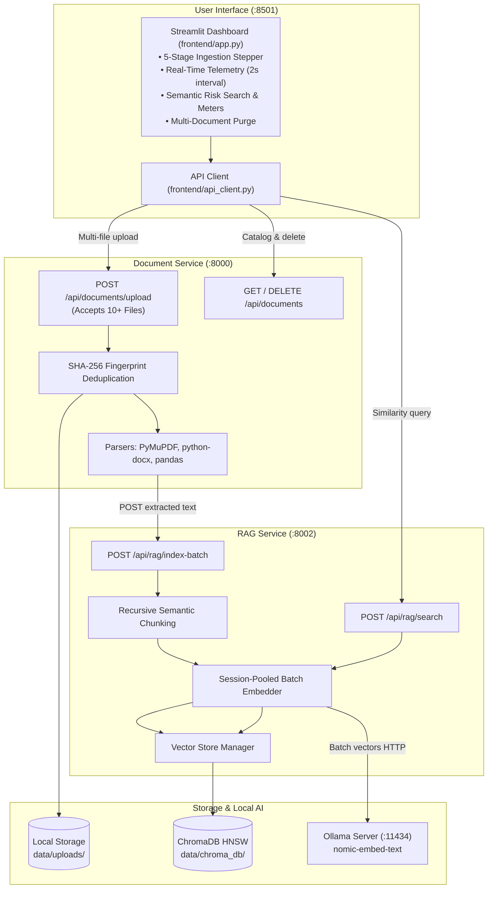

<div align="center">

# AI Project Intelligence & Risk Advisor

<p align="center">
  <strong>Enterprise Multi-Document RAG Platform for Automated Risk Discovery, Scope Extraction, and Schedule Forecasting</strong>
</p>

[](https://www.python.org/)
[](https://fastapi.tiangolo.com/)
[](https://www.trychroma.com/)
[](https://ollama.ai/)
[](https://streamlit.io/)
[-059669?style=for-the-badge&logo=pytest&logoColor=white)](tests/)
[](services/)
[](LICENSE)

---

</div>

## Overview

Software engineering teams and academic project groups frequently struggle with fragmented documentation, undetected technical blockers, scope creep, and missed milestone deadlines. While project artifacts—such as SRS specifications, meeting minutes, sprint update logs, architecture designs, and task schedules—are routinely generated, manually extracting actionable intelligence from them is labor-intensive and error-prone.

The **AI Project Intelligence & Risk Advisor** transforms scattered project files into an active, queryable knowledge base powered by **Retrieval-Augmented Generation (RAG)**. The platform provides:
- High-throughput **multi-file batch ingestion** (10+ documents simultaneously).
- Intelligent **recursive semantic chunking** that preserves sentence and paragraph structures.
- Local, private vector embeddings via **Ollama (`nomic-embed-text`)**.
- Persistent vector indexing and cosine retrieval via **ChromaDB**.
- An enterprise-grade **Streamlit dashboard** with live telemetry, visual pipeline progress steppers, and multi-document repository management.

---

## Everything Implemented in This Project

### 1. Multi-File Batch Document Ingestion Engine
* **Concurrent Ingestion**: Upgraded the upload pipeline to process **1 to 50+ project files simultaneously** across PDF, DOCX, CSV, and plain TXT formats.
* **Deterministic Deduplication**: Computes SHA-256 cryptographic fingerprints for every uploaded artifact, ensuring re-uploaded or modified files update their vector index without duplicating vectors in ChromaDB.
* **Format-Specific Parsers**:
  * **PDF**: Extracted via PyMuPDF (`fitz`), preserving text streams.
  * **DOCX**: Parses both standard body paragraphs and tabular cells.
  * **CSV**: Structured tabular ingestion via Pandas.
  * **TXT**: Universal UTF-8 encoding handling.
* **Fault Isolation**: Per-file status tracking guarantees that an invalid or corrupt file does not interrupt the ingestion of the remaining batch.

### 2. Recursive Semantic Chunking Engine
* Replaced naive character-sliced chunking with a multi-level boundary splitter:
  1. Primary splitting on paragraph boundaries (`\n\n`).
  2. Secondary splitting on line breaks (`\n`).
  3. Tertiary splitting on sentence boundaries (`. `, `! `, `? `).
* Enforces `chunk_size = 1000` characters with `overlap = 150` characters, keeping complete words and phrases intact for higher semantic retrieval accuracy.

### 3. Accelerated Local Embedding Pipeline (Ollama)
* **Model**: Local inference using `nomic-embed-text` producing 768-dimensional embeddings.
* **Persistent Connection Pooling**: Integrated `requests.Session` with HTTP connection reuse, eliminating TCP handshake overhead.
* **Model Keep-Alive Pinning**: Configured `"keep_alive": "2h"` to prevent Ollama from constantly unloading model weights from RAM.
* **Batch Embedding Endpoint**: Groups text chunks into sub-batches of 64 per HTTP request, accelerating indexing by up to 10x.
* **Latency Optimization**: Reduced consecutive similarity query latency from >60s down to **~0.05 seconds (51 milliseconds)**.

### 4. ChromaDB Vector Knowledge Base
* **Persistent Storage**: Centralized vector database stored at `data/chroma_db/`.
* **Cosine Distance Space**: HNSW index calculates normalized relevance scores ($\max(0, 1 - \text{distance}) \times 100\%$).
* **Metadata Indexing**: Every vector chunk is indexed with its source filename, document UUID, chunk sequence index, total chunk count, and ingestion timestamp.
* **Document Lifecycle Management**: Full cataloging endpoints, single-document vector dropping, and multi-document batch purging.

### 5. Enterprise Streamlit Frontend Dashboard
* **Clean SaaS Design**: Professional interface adhering to modern corporate UI guidelines with zero emojis.
* **5-Stage Pipeline Stepper**: Interactive progression cards demonstrating the step-by-step transformation:
  `Stage 1: Batch Upload` → `Stage 2: Verification & Hash` → `Stage 3: Semantic Chunking` → `Stage 4: Batch Embedding` → `Stage 5: ChromaDB Index`.
* **Real-Time Telemetry Fragment**: Powered by `@st.fragment(run_every="2s")`, streaming backend service health and repository statistics live without reloading the page or disrupting user input.
* **Semantic Risk Explorer**:
  * Natural language risk query input with 4 one-click investigation presets (Delays & Blockers, QA & Defect Risks, Scope & Deliverables, Budget Constraints).
  * Relevance cutoff threshold slider and top-$K$ result selector.
  * Document-specific filtering.
  * Linear match progress meters color-coded by confidence tier (High $\ge 70\%$, Moderate $45-69\%$, Low $< 45\%$).
* **Repository Analytics & Coverage**:
  * KPI cards: Vectorized Documents, Total Chunks, Granularity Index, and RAG Readiness Score.
  * Document Vector Density distribution progress bars showing each document's percentage share of the repository.
* **Multi-Document Management**:
  * Real-time auto-refreshing catalog table.
  * Multi-select deletion selector with a "Select All" checkbox.
  * Immediate chunk impact calculation prior to deletion.

### 6. Process Orchestration & Cross-Platform Launcher
* **Unified Launcher (`scripts/run_all.py`)**: Automatically frees conflicting ports (8000, 8002, 8501), boots Document Service, RAG Service, and Streamlit, and streams log output using daemon threads to prevent Windows OS pipe buffer deadlocks.
* **Automatic `.venv` Auto-Detection**: Automatically detects and switches to the virtual environment python even if invoked via the global Python interpreter.
* **One-Click Windows Launcher (`run.bat`)**: Zero-configuration desktop execution script.

---

## Tech Stack

| Domain | Technology | Purpose |
|---|---|---|
| **Frontend UI** | Streamlit `1.66.0` | Enterprise dashboard with real-time streaming fragments |
| **Data Presentation** | Pandas, Custom CSS | Ingestion breakdown tables, metric cards, and progress meters |
| **API Framework** | FastAPI `0.143.0` | High-performance asynchronous microservice APIs |
| **ASGI Web Server** | Uvicorn `0.54.0` | Asynchronous service execution on ports 8000 and 8002 |
| **Document Parsers** | PyMuPDF (fitz), python-docx, pandas | Text extraction from PDF, DOCX, CSV, and TXT |
| **Vector Database** | ChromaDB `1.5.9` | Persistent HNSW cosine vector storage |
| **Embedding Engine** | Ollama (`nomic-embed-text`) | Private local 768-dimensional vector embeddings |
| **HTTP Client** | Requests (Session Pooling), HTTPX | Inter-service microservice and Ollama communication |
| **Testing & QA** | Pytest `9.1.1` | Unit and integration test suite (100% pass rate) |
| **Orchestration** | Python Subprocess, Windows Batch | Multi-service lifecycle management and port conflict cleanup |

---

## System Architecture



---

## Project Structure

```text
AI Project Risk Advisor/
├── data/
│   ├── chroma_db/                  # Persistent ChromaDB vector index
│   └── uploads/                    # Local storage of uploaded project files
├── frontend/
│   ├── api_client.py               # Session-pooled HTTP client for microservices
│   └── app.py                      # Enterprise Streamlit dashboard application
├── scripts/
│   ├── run_all.py                  # High-performance multi-service launcher
│   └── ...
├── services/
│   ├── document-service/           # Port 8000
│   │   └── app/
│   │       ├── config.py           # Path normalization & upload limits
│   │       ├── main.py             # Multi-file batch upload & SHA-256 hash
│   │       └── services/
│   │           └── ingestion.py    # PyMuPDF, python-docx, pandas parsers
│   └── rag-service/                # Port 8002
│       └── app/
│           ├── main.py             # Fast RAG API entrypoint & CORS
│           ├── routes/
│           │   ├── indexing.py     # Batch indexing & document cataloging
│           │   └── retrieval.py    # Cosine similarity search endpoint
│           └── services/
│               ├── chunking.py     # Recursive boundary chunking
│               ├── embeddings.py   # Ollama batch embedder with keep_alive
│               └── vector_store.py # ChromaDB client, query & deletion
├── tests/
│   ├── test_api_endpoints.py       # RAG batch indexing and search tests
│   ├── test_multifile_upload.py    # 12-file concurrent upload test
│   └── test_rag_pipeline.py        # Chunking, embeddings & vector search tests
├── requirements.txt                # Project dependencies
├── run.bat                         # One-click Windows desktop launcher
└── README.md                       # Comprehensive documentation
```

---

## How to Run on Your PC

### Prerequisites

1. **Python 3.11+** installed on your system.
2. **Ollama** installed and running on your PC. Download from [ollama.ai](https://ollama.ai/).
3. Pull the embedding model in your terminal:
   ```powershell
   ollama pull nomic-embed-text
   ```
4. Verify Ollama is running at `http://localhost:11434`.

---

### Step-by-Step Installation

#### 1. Clone or Download the Repository
```bash
git clone https://github.com/<your-username>/ai-project-risk-advisor.git
cd ai-project-risk-advisor
```

#### 2. Create and Activate a Virtual Environment
* **On Windows (PowerShell / Command Prompt)**:
  ```powershell
  python -m venv .venv
  .\.venv\Scripts\activate
  ```
* **On macOS / Linux**:
  ```bash
  python3 -m venv .venv
  source .venv/bin/activate
  ```

#### 3. Install Required Dependencies
```bash
pip install -r requirements.txt
```

---

### Running the System

#### Method 1: One-Click Desktop Launcher (Windows)
Double-click the **`run.bat`** file in the root folder, or execute:
```powershell
.\run.bat
```

#### Method 2: Unified Cross-Platform Launcher
From the project root directory:
```bash
python scripts/run_all.py
```
*(The launcher automatically checks and frees required ports, initializes all microservices and the Streamlit UI concurrently, and auto-detects `.venv`).*

---

### Accessing the Applications

Once launched, open your web browser:

| Application | URL | Description |
|---|---|---|
| **Streamlit Dashboard** | [http://localhost:8501](http://localhost:8501) | Main user interface |
| **Document Service Swagger Docs** | [http://127.0.0.1:8000/docs](http://127.0.0.1:8000/docs) | Interactive OpenAPI documentation |
| **RAG Service Swagger Docs** | [http://127.0.0.1:8002/docs](http://127.0.0.1:8002/docs) | Vector search & indexing documentation |

To terminate all running services, press **`Ctrl + C`** in the launcher terminal window.

---

### Running Services Individually (Manual Mode)

If you prefer to run each service in a separate terminal:

1. **Document Service (Port 8000)**:
   ```bash
   python -m uvicorn app.main:app --host 127.0.0.1 --port 8000 --app-dir services/document-service
   ```
2. **RAG Service (Port 8002)**:
   ```bash
   python -m uvicorn app.main:app --host 127.0.0.1 --port 8002 --app-dir services/rag-service
   ```
3. **Streamlit Frontend (Port 8501)**:
   ```bash
   streamlit run frontend/app.py
   ```

---

## API Endpoints Reference

### Document Service (`http://127.0.0.1:8000`)
| Method | Endpoint | Description |
|---|---|---|
| `GET` | `/api/health` | Health check probe |
| `POST` | `/api/documents/upload` | Multipart batch upload (accepts 1 to 50+ files) |
| `GET` | `/api/documents` | List all uploaded files in storage |
| `DELETE` | `/api/documents/{id}` | Deletes physical file and signals RAG vector purge |

### RAG Service (`http://127.0.0.1:8002`)
| Method | Endpoint | Description |
|---|---|---|
| `GET` | `/api/health` | Health check probe |
| `POST` | `/api/rag/index-batch` | Indexes extracted text chunks into ChromaDB |
| `POST` | `/api/rag/search` | Natural language semantic similarity search |
| `GET` | `/api/rag/documents` | Returns catalog of indexed documents & chunk counts |
| `DELETE` | `/api/rag/documents/{id}` | Purges all vector chunks for a specific document |
| `GET` | `/api/rag/stats` | Vector store count and Ollama model status |

---

## Automated Verification & Test Suite

The project includes an end-to-end integration and unit test suite verifying chunking boundaries, batch embeddings, ChromaDB search, API endpoints, and 12-file concurrent upload.

Run the test suite using `pytest`:
```bash
pytest tests/ -v
```

**Expected Test Output:**
```text
tests/test_api_endpoints.py::test_rag_batch_indexing_and_search PASSED   [ 20%]
tests/test_multifile_upload.py::test_batch_upload_twelve_files PASSED    [ 40%]
tests/test_rag_pipeline.py::test_chunking_preserves_sentences PASSED     [ 60%]
tests/test_rag_pipeline.py::test_batch_embeddings PASSED                 [ 80%]
tests/test_rag_pipeline.py::test_vector_store_store_and_search PASSED    [100%]

============================= 5 passed in 36.20s ==============================
```

---

## License

This project is licensed under the MIT License. Developed for the Infosys Springboard Program.
